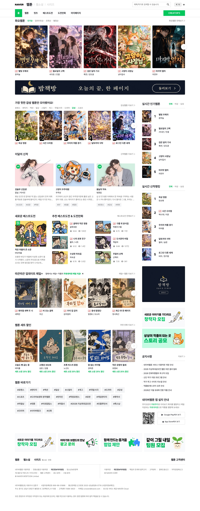
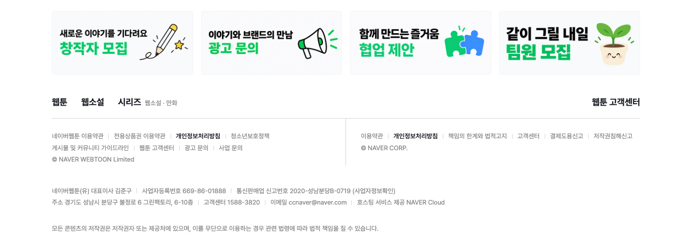
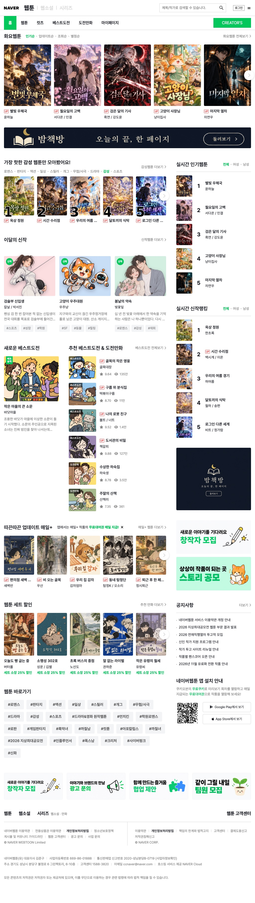

# 네이버 웹툰 메인 페이지 클론 코딩


`Semantic HTML` `Web Accessibility` `Flexbox` `Grid` `Responsive` `CSS Variables` `Container Query`

네이버 웹툰 PC 메인 페이지를 HTML · CSS로 클론 코딩한 프로젝트입니다.
화면을 구역 단위로 분석해 시맨틱 구조와 웹 접근성을 갖추고, Flex · Grid와 CSS 변수로 **데스크톱 · 태블릿 · 모바일**에 대응하는 재사용 가능한 스타일 구조를 만들었습니다.

- 작업 기간 (커밋 기준): 1차 2026.10.06 ~ 10.12 · 2차 2026.11.14 ~ 11.15
- 대응 화면 (디바이스별 표준 브레이크포인트): 데스크톱(1024px 이상) · 태블릿(768~1023px) · 모바일(767px 이하)

<br />

## 핵심 구현 포인트

| 구분 | 내용 |
|---|---|
| 구조적 마크업 | `header` · `nav` · `main` · `section` · `aside` · `footer` · `address`로 영역을 나누고, 검색은 `form` + `label`, 순위 목록은 `ol`로 작성 |
| 웹 접근성 · 가독성 | 모든 이미지 `alt`, `aria-label`로 여러 `nav` 구분, `aria-pressed` · `aria-current`, `.sr-only` 라벨, `:focus-visible` · `:focus-within` 포커스 표시 |
| 레이아웃 · 반응형 | Flex(목록 · 헤더) + Grid(본문 2단 · 이달의 신작 · 푸터 `grid-template-areas`), 표준 브레이크포인트 3단계와 `clamp()` · `auto-fit` 유동 처리 |
| 재사용 스타일 구조 | `:root` 디자인 토큰, 공통 컴포넌트(섹션 머리말 · 필터 · 포스터 카드 · 배너), 크기 수정자 클래스, 컨테이너 쿼리로 포스터 크기 자동 계산 |
| 시각 효과 | 투명 PNG + `clip-path`로 캐릭터가 틀 밖으로 튀어나오는 입체 효과, 모바일 가로 스크롤 `scroll-snap` |

> 항목별 커밋과 코드 위치는 [구현 상세](./readme/implementation.md)에서 확인할 수 있습니다.

<br />

## 스크린샷

### 전체 화면 (PC 1400px)



### 부분 화면

#### 헤더


#### 메인


#### 푸터



### 반응형

<table>
  <tr>
    <th>데스크톱 최소 폭 (1024px)</th>
    <th>태블릿 (768px)</th>
    <th>모바일 (375px)</th>
  </tr>
  <tr>
    <td valign="top">
      
    </td>
    <td valign="top">
      
    </td>
    <td valign="top">
      
    </td>
  </tr>
</table>

| 구간 | 미디어 쿼리 | 바뀌는 것 |
|---|---|---|
| 데스크톱 | `min-width: 1024px` (기본 스타일) | 원본과 같은 본문 \| aside 2단. 화면이 좁아지면 포스터 · 간격 · 추천 목록 열 수가 미디어 쿼리 없이 자동으로 줄어듦 |
| 태블릿 | `min-width: 768px and max-width: 1023px` | aside를 본문 아래로 내리고, aside 안은 2열(랭킹 2개 나란히 · 광고 \| 공지 · 앱 설치) |
| 모바일 | `max-width: 767px` | 1단 배치 · 작품 목록은 손가락으로 넘기는 가로 스크롤 · 헤더 링크 축소 · 푸터 1열 |

<br />

## 실행 방법

```bash
git clone https://github.com/bsis09872-ux/naver-webtoon-clone.git
```

```bash
cd naver-webtoon-clone
```

`main-page`가 상위 폴더의 `common.css`를 불러오므로 **저장소 최상위 폴더**에서 서버를 실행합니다.

```bash
python3 -m http.server 5500
```

브라우저에서 `http://localhost:5500/main-page/index.html`을 엽니다.

> - VS Code **Live Server** 확장으로 `main-page/index.html`을 열어도 됩니다.
> - 폰트(Pretendard)와 아이콘(Font Awesome)은 CDN에서 불러오므로 인터넷 연결이 필요합니다.
> - 반응형 확인: 개발자 도구(`F12`) → 기기 툴바(`Ctrl/Cmd + Shift + M`)에서 폭을 1024px, 768px, 375px로 바꿔 보세요.

<br />

## 더 알아보기

| 문서 | 내용 |
|---|---|
| [원본 분석과 설계](./readme/analysis.md) | 개발자 도구로 원본 구조 분석, 영역 분석표, 계획에서 바뀐 부분 |
| [구현 상세](./readme/implementation.md) | 구조 · 레이아웃 · 접근성 · 재사용 구조별 커밋과 코드 위치 |
| [회고](./readme/retrospective.md) | 작업 기간, 배운 기술 스택, 소감, 트러블 슈팅 |

<br />

## 폴더 구조

```
naver-webtoon-clone
├── common.css              # 폰트 · 초기화 · 전역 변수 · 공통 유틸리티
├── main-page
│   ├── index.html          # 메인 페이지 마크업
│   ├── css/style.css       # 메인 페이지 스타일 (0~14번 섹션)
│   ├── js/main-page.js     # 필터 버튼 선택 모양 전환
│   ├── icons/              # 랭킹 뱃지 등 아이콘
│   └── images/             # 포스터 · 배너 · QR 이미지
└── readme
    ├── analysis.md         # 원본 분석과 설계
    ├── implementation.md   # 구현 상세
    ├── retrospective.md    # 작업 기간 · 기술 스택 · 회고
    └── screenshots/        # 캡처 이미지
```

> - 작품 포스터, 작품명, 작가명, 배너는 저작권을 고려해 생성형 AI로 만든 가상 콘텐츠입니다. (원본에서 가져온 것은 상단 로고와 QR 코드뿐입니다.)
> - `js/main-page.js`는 필터 버튼을 눌렀을 때 선택 모양만 바꾸는 최소 스크립트이며, 이 프로젝트는 HTML · CSS 구현에 집중했습니다.
