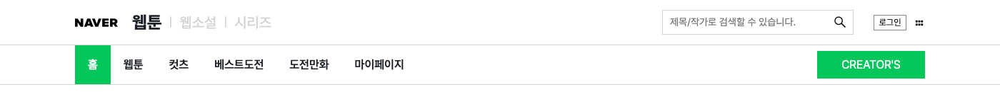
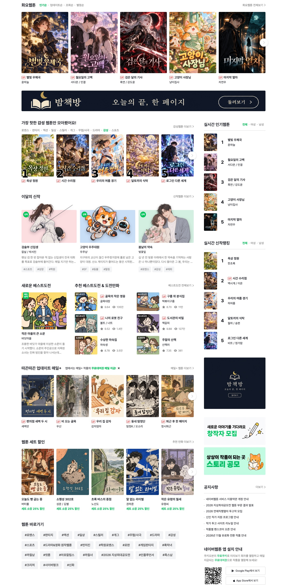
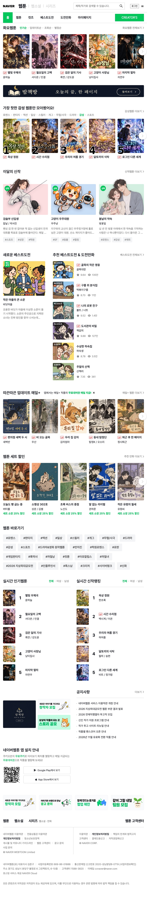
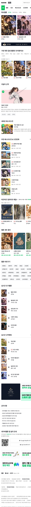
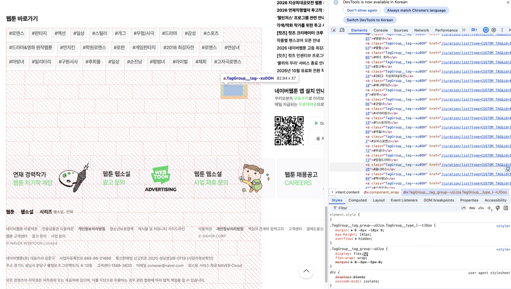
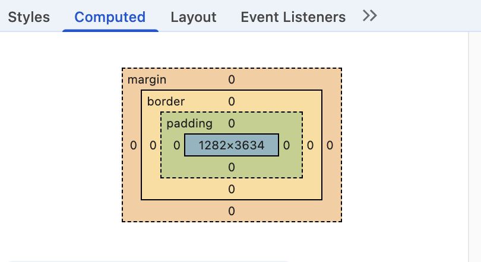

# naver-webtoon-clone

네이버 웹툰 PC 메인 페이지를 HTML · CSS로 클론 코딩한 과제입니다.
시맨틱 마크업과 웹 접근성, Flex · Grid 기반 반응형 레이아웃, CSS 변수로 만든 재사용 스타일 구조에 집중했습니다.

- 사용 기술: HTML5, CSS3 (Flexbox, Grid, CSS 변수, 컨테이너 쿼리, 미디어 쿼리)
- 대응 화면 (디바이스별 표준 브레이크포인트): 데스크톱(1024px 이상) · 태블릿(768~1023px) · 모바일(767px 이하)

### 목차

1. [화면 보는 방법](#화면-보는-방법)
2. [스크린샷](#스크린샷)
3. [원본 분석과 설계](#원본-분석과-설계)
4. [과제 구현 내용](#과제-구현-내용)
5. [폴더 구조](#폴더-구조)

### 채점 기준 대응 요약

| 채점 항목 | 5점 기준 | 이 프로젝트에서 확인할 곳 |
|---|---|---|
| HTML 마크업 | 시맨틱 태그로 구조적 페이지 작성 + 웹 접근성(라벨 · 대체 텍스트 등) + 마크업 가독성 | [구조적 마크업](#필수-구조적-마크업-작성) · [웹 접근성 및 가독성](#심화-웹-접근성-및-가독성-확보) |
| CSS 스타일링 | Flex · Grid 반응형 레이아웃 + 다양한 브레이크포인트 대응 + 재사용 가능한 스타일 구조 | [레이아웃 구현](#필수-웹-페이지-레이아웃-구현) · [반응형 화면](#반응형) · [재사용 스타일 구조](#심화-재사용-가능한-스타일-구조) |

<br />

## 화면 보는 방법

### 1. 저장소 내려받기

```bash
git clone https://github.com/bsis09872-ux/naver-webtoon-clone.git
```

```bash
cd naver-webtoon-clone
```

### 2. 로컬 서버 실행 (저장소 최상위 폴더에서)

`main-page`가 상위 폴더의 `common.css`를 불러오므로 **저장소 최상위 폴더**에서 서버를 실행합니다.

```bash
python3 -m http.server 5500
```

### 3. 브라우저에서 열기

```
http://localhost:5500/main-page/index.html
```

> - VS Code를 쓴다면 **Live Server** 확장으로 `main-page/index.html`을 열어도 됩니다.
> - 폰트(Pretendard)와 아이콘(Font Awesome)은 CDN에서 불러오므로 인터넷 연결이 필요합니다.
> - 반응형 확인: 개발자 도구(`F12`) → 기기 툴바(`Ctrl/Cmd + Shift + M`)에서 폭을 1024px(데스크톱 최소 폭), 768px(태블릿), 375px(모바일)로 바꿔 보세요.

<br />

## 스크린샷

### 전체 화면 (PC 1400px)


### 부분 화면

#### 헤더



#### 메인



#### 푸터


### 반응형

<table>
  <tr>
    <th>데스크톱 최소 폭 (1024px)</th>
    <th>태블릿 (768px)</th>
    <th>모바일 (375px)</th>
  </tr>
  <tr>
    <td valign="top">
      
    </td>
    <td valign="top">
      
    </td>
    <td valign="top">
      
    </td>
  </tr>
</table>

| 구간 | 미디어 쿼리 | 바뀌는 것 |
|---|---|---|
| 데스크톱 | `min-width: 1024px` (기본 스타일) | 원본과 같은 본문 \| aside 2단. 화면이 좁아지면 포스터 · 간격 · 추천 목록 열 수가 미디어 쿼리 없이 자동으로 줄어듦 |
| 태블릿 | `min-width: 768px and max-width: 1023px` | aside를 본문 아래로 내리고, aside 안은 2열(랭킹 2개 나란히 · 광고 \| 공지 · 앱 설치) |
| 모바일 | `max-width: 767px` | 1단 배치 · 작품 목록은 손가락으로 넘기는 가로 스크롤 · 헤더 링크 축소 · 푸터 1열 |

<br />

## 원본 분석과 설계

구현 전에 원본 페이지를 개발자 도구로 살펴보고, 영역마다 **원본에서 확인한 것 → HTML 구조 → CSS 배치**를 표로 정리한 뒤 코딩했습니다.
(분석 환경: 맥북 에어 15인치, Chrome 전체 화면)

<table>
  <tr>
    <td valign="top">
      
    </td>
    <td valign="top">
      
    </td>
  </tr>
  <tr>
    <td>원본 DOM 확인 (웹툰 바로가기 · ul + Flex)</td>
    <td>박스 모델 확인</td>
  </tr>
</table>

### 영역 분석표 (요약)

| 영역 | 원본에서 확인한 것 | HTML 구조 | CSS 배치 · 좁은 화면 대응 |
|---|---|---|---|
| 헤더 · 로고 | 서비스별 이동 링크 | `h1` + `nav` › `ul` › `li` › `a` | Flex 가로 정렬 · 모바일에서 서비스 링크 숨김 |
| 헤더 · 검색 | 원본은 `input`만 있고 `form`이 없음 | `form role="search"` + `label` + `input` | Flex · 모바일에서 검색창 축소 |
| 주요 내비게이션 | CREATOR'S는 작가용 링크로 역할이 다름 | `nav` › `ul` › `li` › `a`, 현재 메뉴 `aria-current` | Flex · 모바일 가로 스크롤 |
| 요일 웹툰 | DOM에서 `ul` + Flex 확인, 캐러셀 | `section` › `h2`, `ul` › `li` | Flex · 모바일 가로 스크롤 |
| 본문 · aside 2단 | 가로 광고 아래부터 두 열 | 배치용 `div` 안에 왼쪽 묶음 + `aside` | Grid(원본의 Grid 사용을 확인한 것은 아니고 개인 판단으로 채택) · 태블릿부터 1단, aside 안은 2열 |
| 장르별 인기 · 매일+ · 세트 할인 | 가로 작품 목록 | `section` › `h2`, `ul` › `li` | Flex · 모바일 가로 스크롤 |
| 이달의 신작 | 소개 · 태그가 있는 카드 3개 | `ul` › `li`, 소개 `p`, 태그 `ul` | Grid 3열(개인 판단) · 모바일 가로 스크롤 |
| 베스트도전 | 대표 작품과 추천 목록이 나란히 | `section` 2개 | 상위 Grid 2단 · 목록 Grid · 좁은 화면에서 세로 배치 |
| 웹툰 바로가기 | 작품 카드가 아닌 해시태그 링크 목록 | `ul` › `li` › `a` | Flex + `flex-wrap` 자연 줄바꿈 |
| 실시간 랭킹 | 순위가 의미 있는 세로 목록 | `aside` 안 `section` › `h2`, `ol` › `li` | 항목 내부 Grid(썸네일 · 순위 · 제목) |
| 공지 · 앱 설치 | 세로 텍스트 목록, QR + 스토어 링크 | `ul` › `li` › `a`, `img` + `a` | 긴 제목 말줄임 · QR과 링크 Flex |
| 푸터 | 배너 4개, 서비스 링크, 약관 · 회사 정보 | `footer` › `ul` · `nav` · `address` | `grid-template-areas` · 모바일 1열 |

### 계획에서 바뀐 부분

| 처음 계획 | 실제 구현 | 바꾼 이유 |
|---|---|---|
| 이달의 신작 3열 → 2열 → 1열 | 3열 유지, 모바일은 한 장씩 가로로 넘기기 | 캐릭터가 틀 위로 튀어나오는 입체 효과를 카드 크기를 유지한 채 보여주기 위해 |
| 서비스 · 푸터 배너를 CSS 상자와 텍스트로 | 준비한 배너 이미지 + 대체 텍스트(`alt`) | 배너 디자인을 그대로 재현하고, 내용은 `alt`로 전달 |
| 저작권 문구 `small` | `p` | 문단 단위 안내문이라 일반 문단으로 처리 |
| 포스터 hover 약 1.03배 확대 | 1.2배 확대 + 0.3s 전환 | 확대가 눈에 띄도록 조정 |

<br />

## 과제 구현 내용

각 항목의 **커밋**은 해당 기능을 구현한 커밋이고, **코드 확인하기**는 현재 코드에서 그 부분의 위치입니다.

### [필수] 구조적 마크업 작성

| 구현 내용 | 커밋 | 코드 확인하기 |
|---|---|---|
| 헤더: `header` › `h1` 로고 · `nav` 서비스 링크 · 검색 `form` | [0bb33c6](https://github.com/bsis09872-ux/naver-webtoon-clone/commit/0bb33c6) | [index.html L21-106](main-page/index.html#L21-L106) |
| 검색 폼: `form role="search"` + `label` + `input type="search"` + 제출 버튼 | [cb88d08](https://github.com/bsis09872-ux/naver-webtoon-clone/commit/cb88d08) | [index.html L55-66](main-page/index.html#L55-L66) |
| 본문: `main` › 섹션마다 `section` + `h2` 제목 | [cb88d08](https://github.com/bsis09872-ux/naver-webtoon-clone/commit/cb88d08) | [index.html L107-1099](main-page/index.html#L107-L1099) |
| 사이드: `aside` › 실시간 순위는 순서가 있는 `ol` 목록 | [73eaced](https://github.com/bsis09872-ux/naver-webtoon-clone/commit/73eaced) | [index.html L859-1097](main-page/index.html#L859-L1097) |
| 푸터: `footer` › `nav` 바로가기 · 사업자 정보 `address` | [73eaced](https://github.com/bsis09872-ux/naver-webtoon-clone/commit/73eaced) | [index.html L1100-1227](main-page/index.html#L1100-L1227) |
| 문서 오류 수정: doctype, 닫히지 않은 태그, 클래스명 오타 | [9747e08](https://github.com/bsis09872-ux/naver-webtoon-clone/commit/9747e08) | [index.html L1](main-page/index.html#L1) |

### [필수] 웹 페이지 레이아웃 구현

| 구현 내용 | 커밋 | 코드 확인하기 |
|---|---|---|
| 박스 모델: 전역 `box-sizing: border-box` 초기화 | [0bb33c6](https://github.com/bsis09872-ux/naver-webtoon-clone/commit/0bb33c6) | [common.css L51-56](common.css#L51-L56) |
| Flex: 헤더 브랜드바 · 메뉴 좌우 배치 | [0bb33c6](https://github.com/bsis09872-ux/naver-webtoon-clone/commit/0bb33c6) | [style.css L59-222](main-page/css/style.css#L59-L222) |
| Flex: 포스터 가로 목록 + 캐러셀 다음 버튼 | [c8c97a7](https://github.com/bsis09872-ux/naver-webtoon-clone/commit/c8c97a7) | [style.css L306-362](main-page/css/style.css#L306-L362) |
| Grid: 본문 \| aside 2단 배치 | [0f4817b](https://github.com/bsis09872-ux/naver-webtoon-clone/commit/0f4817b) | [style.css L30-44](main-page/css/style.css#L30-L44) |
| Grid: 이달의 신작 3열 · 베스트도전 2단 · 실시간 순위 행 | [73eaced](https://github.com/bsis09872-ux/naver-webtoon-clone/commit/73eaced) | [style.css L576-677](main-page/css/style.css#L576-L677) |
| Grid: 푸터 `grid-template-areas` 영역 배치 | [73eaced](https://github.com/bsis09872-ux/naver-webtoon-clone/commit/73eaced) | [style.css L753-870](main-page/css/style.css#L753-L870) |
| 반응형: 표준 브레이크포인트 — 태블릿(`min-width: 768px and max-width: 1023px`) · 모바일(`max-width: 767px`) | [3ac9359](https://github.com/bsis09872-ux/naver-webtoon-clone/commit/3ac9359) · [2e9b609](https://github.com/bsis09872-ux/naver-webtoon-clone/commit/2e9b609) | [style.css L871-1054](main-page/css/style.css#L871-L1054) |
| 데스크톱(1024px 이상) 안에서는 미디어 쿼리 없이 유동 처리: `clamp()` 간격 · `auto-fit` 추천 목록 열 수 | [2e9b609](https://github.com/bsis09872-ux/naver-webtoon-clone/commit/2e9b609) | [style.css L30-44](main-page/css/style.css#L30-L44) · [L626-634](main-page/css/style.css#L626-L634) |

### [심화] 웹 접근성 및 가독성 확보

| 구현 내용 | 커밋 | 코드 확인하기 |
|---|---|---|
| 검색창 `label`을 화면에서 숨기고 스크린리더에만 읽히는 `.sr-only` | [cb88d08](https://github.com/bsis09872-ux/naver-webtoon-clone/commit/cb88d08) | [index.html L56](main-page/index.html#L56) · [common.css L111-121](common.css#L111-L121) |
| 여러 `nav`를 구분하는 `aria-label` (콘텐츠 서비스 / 웹툰 메뉴 / 푸터 바로가기) | [cb88d08](https://github.com/bsis09872-ux/naver-webtoon-clone/commit/cb88d08) | [index.html L33](main-page/index.html#L33) · [L80](main-page/index.html#L80) · [L1125](main-page/index.html#L1125) |
| 필터 버튼의 선택 상태를 `aria-pressed`로 전달 | [cb88d08](https://github.com/bsis09872-ux/naver-webtoon-clone/commit/cb88d08) | [index.html L115](main-page/index.html#L115) |
| 현재 페이지 메뉴(홈)에 `aria-current="page"` | [2e9b609](https://github.com/bsis09872-ux/naver-webtoon-clone/commit/2e9b609) | [index.html L83](main-page/index.html#L83) |
| 모든 이미지 대체 텍스트(`alt`), 장식 아이콘은 `aria-hidden="true"` | [cb88d08](https://github.com/bsis09872-ux/naver-webtoon-clone/commit/cb88d08) | [index.html L1080](main-page/index.html#L1080) |
| 키보드 포커스 표시 `:focus-visible` | [cb88d08](https://github.com/bsis09872-ux/naver-webtoon-clone/commit/cb88d08) | [common.css L123-126](common.css#L123-L126) |
| 검색창 입력 중 테두리 강조 `:focus-within` | [2e9b609](https://github.com/bsis09872-ux/naver-webtoon-clone/commit/2e9b609) | [style.css L133-139](main-page/css/style.css#L133-L139) |
| 마크업 가독성: 중첩 태그 줄 개행 · 섹션 주석 · 의미 있는 클래스명 | [9601f55](https://github.com/bsis09872-ux/naver-webtoon-clone/commit/9601f55) | [index.html L107-200](main-page/index.html#L107-L200) |

### [심화] 재사용 가능한 스타일 구조

| 구현 내용 | 커밋 | 코드 확인하기 |
|---|---|---|
| 디자인 토큰: 색 · 레이아웃 폭 · 간격 · 글자 크기를 `:root` CSS 변수로 관리 | [9601f55](https://github.com/bsis09872-ux/naver-webtoon-clone/commit/9601f55) | [common.css L23-48](common.css#L23-L48) |
| 목차 주석으로 나눈 스타일 구조 (0~14번 섹션) | [9601f55](https://github.com/bsis09872-ux/naver-webtoon-clone/commit/9601f55) | [style.css L1-18](main-page/css/style.css#L1-L18) |
| 공통 컴포넌트: `.section_head` · `.filter_list` · `.poster_card` · `.banner` 를 모든 섹션에서 재사용 | [9601f55](https://github.com/bsis09872-ux/naver-webtoon-clone/commit/9601f55) | [style.css L223-560](main-page/css/style.css#L223-L560) |
| 크기 수정자 클래스: `.poster_lg` / `.poster_md` / `.poster_tall` 변수만 바꿔 같은 카드 재사용 | [9601f55](https://github.com/bsis09872-ux/naver-webtoon-clone/commit/9601f55) | [style.css L334-355](main-page/css/style.css#L334-L355) |
| 컨테이너 쿼리(`cqw`)로 포스터 크기 자동 계산 → 브레이크포인트에서는 `--poster-count`만 변경 | [3ac9359](https://github.com/bsis09872-ux/naver-webtoon-clone/commit/3ac9359) | [style.css L343-351](main-page/css/style.css#L343-L351) |
| 태그 컴포넌트 재사용 (`.tag_list` + `.tag_list_lg`), `hidden` 속성으로 노출 태그 선택 | [db8a63f](https://github.com/bsis09872-ux/naver-webtoon-clone/commit/db8a63f) | [style.css L463-476](main-page/css/style.css#L463-L476) · [index.html L753-857](main-page/index.html#L753-L857) |

<br />

## 폴더 구조

```
naver-webtoon-clone
├── common.css            # 폰트 · 초기화 · 전역 변수 · 공통 유틸리티
├── main-page
│   ├── index.html        # 메인 페이지 마크업
│   ├── css/style.css     # 메인 페이지 스타일 (0~14번 섹션)
│   ├── js/main-page.js   # 필터 버튼 선택 모양 전환 (평가 대상 아님)
│   ├── icons/            # 랭킹 뱃지 등 아이콘
│   └── images/           # 포스터 · 배너 · QR 이미지
└── screenshots           # README 캡처 이미지
```

> - 작품 포스터, 작품명, 작가명, 배너는 과제용으로 만든 가상 콘텐츠입니다.
> - `js/main-page.js`는 필터 버튼을 눌렀을 때 선택 모양만 바꾸는 최소 스크립트입니다. 이번 과제(HTML · CSS)의 평가 대상이 아닙니다.
