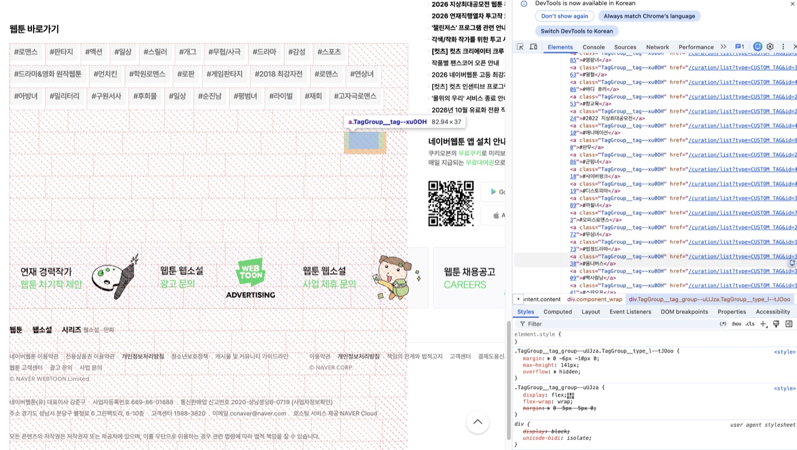
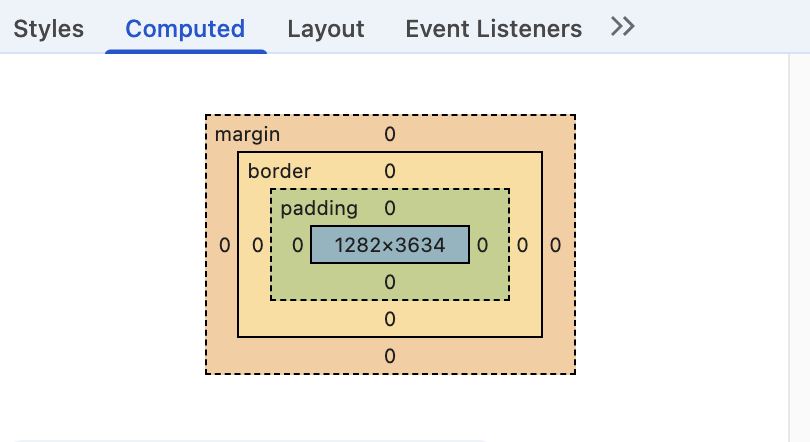

# 원본 분석과 설계

[← README로 돌아가기](../README.md)

 

구현 전에 원본 페이지를 개발자 도구로 살펴보고, 영역마다 **원본에서 확인한 것 → HTML 구조 → CSS 배치**를 표로 정리한 뒤 코딩했습니다.
(분석 환경: 맥북 에어 15인치, Chrome 전체 화면)

<table>
  <tr>
    <td valign="top">
      
    </td>
    <td valign="top">
      
    </td>
  </tr>
  <tr>
    <td>원본 DOM 확인 (웹툰 바로가기 · ul + Flex)</td>
    <td>박스 모델 확인</td>
  </tr>
</table>

## 영역 분석표 (요약)

| 영역 | 원본에서 확인한 것 | HTML 구조 | CSS 배치 · 좁은 화면 대응 |
|---|---|---|---|
| 헤더 · 로고 | 서비스별 이동 링크 | `h1` + `nav` › `ul` › `li` › `a` | Flex 가로 정렬 · 모바일에서 서비스 링크 숨김 |
| 헤더 · 검색 | 원본은 `input`만 있고 `form`이 없음 | `form role="search"` + `label` + `input` | Flex · 모바일에서 검색창 축소 |
| 주요 내비게이션 | CREATOR'S는 작가용 링크로 역할이 다름 | `nav` › `ul` › `li` › `a`, 현재 메뉴 `aria-current` | Flex · 모바일 가로 스크롤 |
| 요일 웹툰 | DOM에서 `ul` + Flex 확인, 캐러셀 | `section` › `h2`, `ul` › `li` | Flex · 모바일 가로 스크롤 |
| 본문 · aside 2단 | 가로 광고 아래부터 두 열 | 배치용 `div` 안에 왼쪽 묶음 + `aside` | Grid(원본의 Grid 사용을 확인한 것은 아니고 개인 판단으로 채택) · 태블릿부터 1단, aside 안은 2열 |
| 장르별 인기 · 매일+ · 세트 할인 | 가로 작품 목록 | `section` › `h2`, `ul` › `li` | Flex · 모바일 가로 스크롤 |
| 이달의 신작 | 소개 · 태그가 있는 카드 3개 | `ul` › `li`, 소개 `p`, 태그 `ul` | Grid 3열(개인 판단) · 모바일 가로 스크롤 |
| 베스트도전 | 대표 작품과 추천 목록이 나란히 | `section` 2개 | 상위 Grid 2단 · 목록 Grid · 좁은 화면에서 세로 배치 |
| 웹툰 바로가기 | 작품 카드가 아닌 해시태그 링크 목록 | `ul` › `li` › `a` | Flex + `flex-wrap` 자연 줄바꿈 |
| 실시간 랭킹 | 순위가 의미 있는 세로 목록 | `aside` 안 `section` › `h2`, `ol` › `li` | 항목 내부 Grid(썸네일 · 순위 · 제목) |
| 공지 · 앱 설치 | 세로 텍스트 목록, QR + 스토어 링크 | `ul` › `li` › `a`, `img` + `a` | 긴 제목 말줄임 · QR과 링크 Flex |
| 푸터 | 배너 4개, 서비스 링크, 약관 · 회사 정보 | `footer` › `ul` · `nav` · `address` | `grid-template-areas` · 모바일 1열 |

## 계획에서 바뀐 부분

| 처음 계획 | 실제 구현 | 바꾼 이유 |
|---|---|---|
| 이달의 신작 3열 → 2열 → 1열 | 3열 유지, 모바일은 한 장씩 가로로 넘기기 | 캐릭터가 틀 위로 튀어나오는 입체 효과를 카드 크기를 유지한 채 보여주기 위해 |
| 서비스 · 푸터 배너를 CSS 상자와 텍스트로 | 준비한 배너 이미지 + 대체 텍스트(`alt`) | 배너 디자인을 그대로 재현하고, 내용은 `alt`로 전달 |
| 저작권 문구 `small` | `p` | 문단 단위 안내문이라 일반 문단으로 처리 |
| 포스터 hover 약 1.03배 확대 | 1.2배 확대 + 0.3s 전환 | 확대가 눈에 띄도록 조정 |
